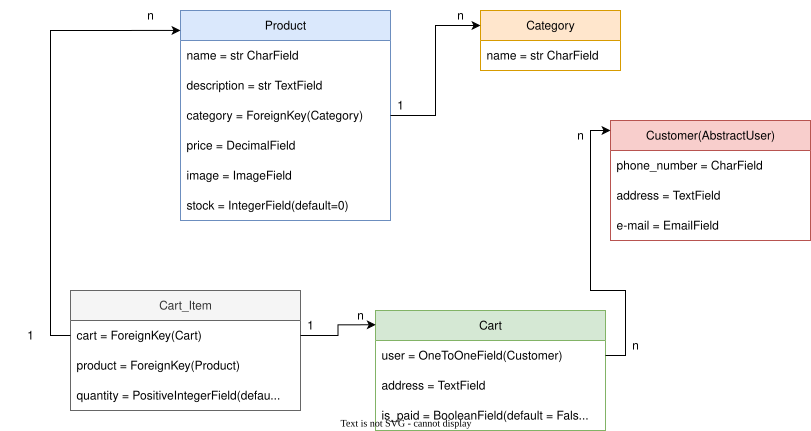

# Online-pet-store

Create an online store where you can choose a product, add it to the cart and place an order

## Technology Stack
- **Framework:** Django 5.2.3
- **Database:** PostgreSQL
- **API:** Django REST Framework
- **Authentication:** JWT + Google OAuth2
- **Deployment:** AWS Elastic Beanstalk + RDS

# backend

<h2 style="font-size:20px;text-align:center;">Diagram</h2>

=======
